# zabbix-widget-event-timeline

[English](README.md) | 日本語

## 概要

Event Timeline は、Zabbix のイベントを時間軸、ホスト、ホストグループ、イベント単位で可視化し、ダッシュボード上で対象を切り替えながら分析できるウィジェットです。

[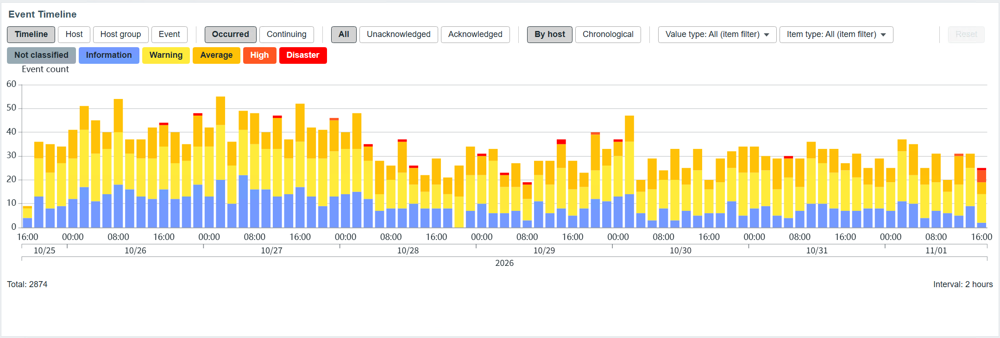](docs/images/event-timeline-dashboard-overview.png)

## Event Timeline を使う理由

Zabbix 標準の障害画面では、個々の障害イベントを一覧で確認できます。ただし、イベントが多い環境では、一定期間内の発生の偏り、特定のホストやホストグループへの集中、イベント種類ごとの差を同じ画面で比較することは容易ではありません。

Event Timeline は、障害イベントの件数を時間単位ごとの棒グラフとして表示し、ホスト、ホストグループ、イベントの各視点へ切り替えられます。これにより、いつ、どこで、どのような障害が集中しているかをダッシュボード上で分析できます。

## 特徴

- **4つの表示モード**: タイムライン、ホスト、ホストグループ、イベントを切り替え、ツールチップとドリルダウンで詳細を確認できます。
- **ナビゲータ連携**: 連携可能なナビゲータウィジェットからホスト、ホストグループ、トリガーを受け取れます。
- **多条件フィルター**: 深刻度、確認状態、値の型、アイテムタイプなどを組み合わせて表示対象を絞り込めます。
- **トリガー / LLD 対応**: テンプレートのトリガー継承と LLD のトリガープロトタイプを追跡し、対象ホスト上のイベントを特定します。
- **時間軸と時間単位処理**: 表示期間に応じて時間単位を自動選択し、ユーザーのタイムゾーンと暦を反映します。

### 表示モード

| タイムライン | ホスト |
| --- | --- |
| 表示期間を自動選択した時間単位に分け、障害イベント数を深刻度別の積み上げ棒グラフで表示します。 | ホストごとの障害イベント数を深刻度別に比較します。並び替えとページ送りを利用できます。 |
| [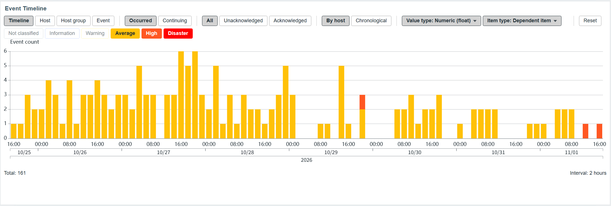](docs/images/event-timeline-timeline-view.png) | [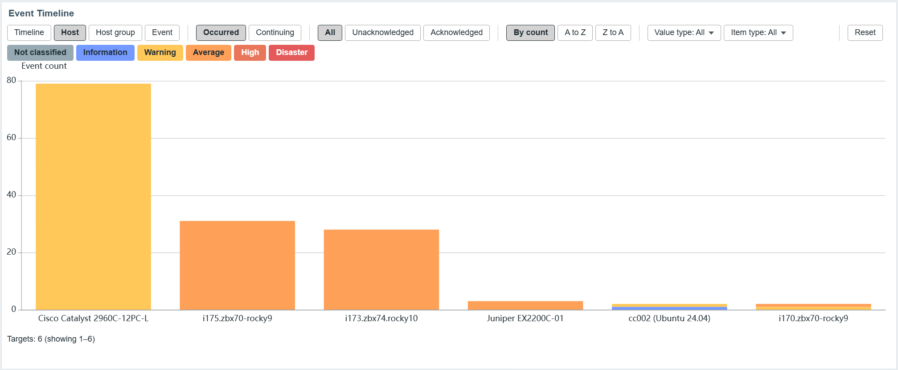](docs/images/event-timeline-by-host.png) |
| **ホストグループ** | **イベント** |
| ホストグループごとの障害イベント数を比較し、影響が集中しているグループを確認します。 | トリガーまたは最上位プロトタイプごとに、影響ホスト数とイベント発生数を比較します。 |
| [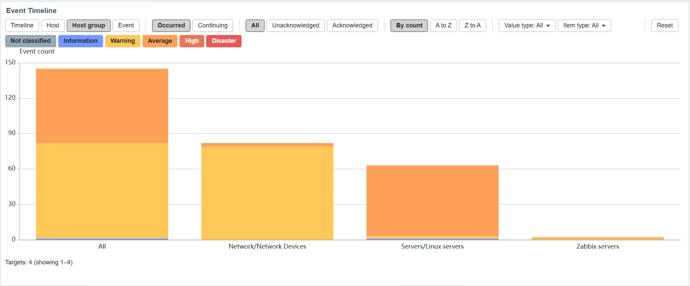](docs/images/event-timeline-by-host-group.png) | [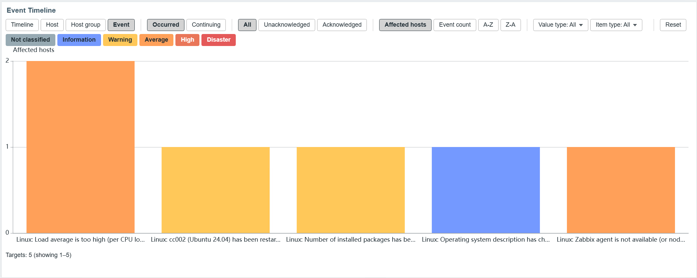](docs/images/event-timeline-by-event.png) |

## 設定項目

設定画面は5タブ構成です。「タイプ」「名前」「リフレッシュ間隔」「ヘッダーを表示」は、Zabbix 標準ウィジェットと同様にタブ外にあります。

| タブ | 項目 |
| --- | --- |
| 対象 | ホスト、ホストグループ、トリガー、イベント取得上限数 |
| 表示 | 表示モード、イベント表示、並び順、集計方法、グラフの1ページ表示件数、自動ページ送り、詳細一覧の1ページ表示件数 |
| フィルター | 深刻度、確認状態、値の型、アイテムタイプ |
| 期間 | 期間、週の開始曜日 |
| 外観 | グラフの高さ、Y軸最小値、X軸ラベル、線の色、文字の色 |

設定画面は「対象」タブで開き、タブ移動中も未保存値を保持します。入力エラーがあるタブへ印を付け、最初のエラータブを開いて項目へフォーカスします。深刻度と確認状態は最低1件の選択が必要です。値の型とアイテムタイプの「すべて」は、条件なしを表す排他的な選択肢です。

各画像を選択すると、設定項目を原寸で確認できます。

<table>
  <tr>
    <td align="center" valign="top" width="20%">
      <strong>対象</strong><br>
      <a href="docs/images/event-timeline-settings-targets-ja.png">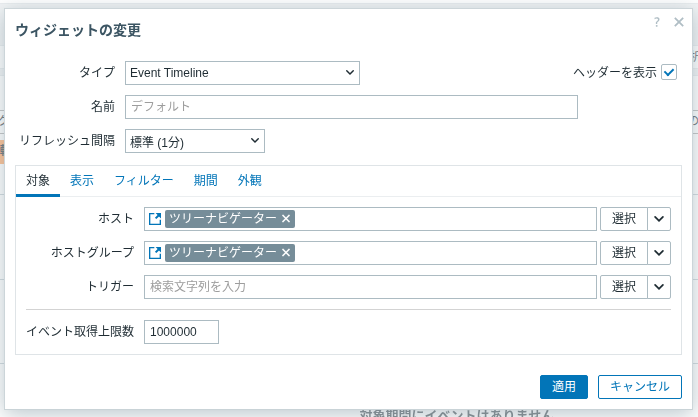</a>
    </td>
    <td align="center" valign="top" width="20%">
      <strong>表示</strong><br>
      <a href="docs/images/event-timeline-settings-display-ja.png">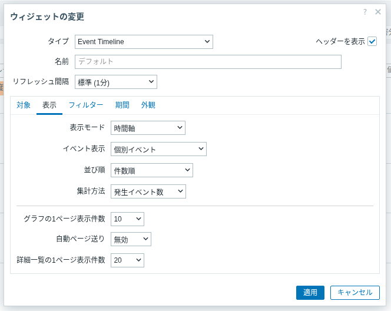</a>
    </td>
    <td align="center" valign="top" width="20%">
      <strong>フィルター</strong><br>
      <a href="docs/images/event-timeline-settings-filters-ja.png">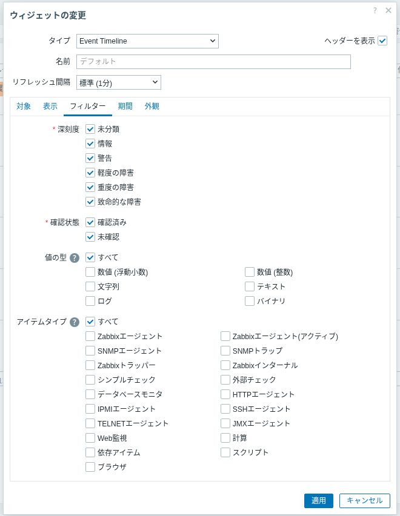</a>
    </td>
    <td align="center" valign="top" width="20%">
      <strong>期間</strong><br>
      <a href="docs/images/event-timeline-settings-time-period-ja.png">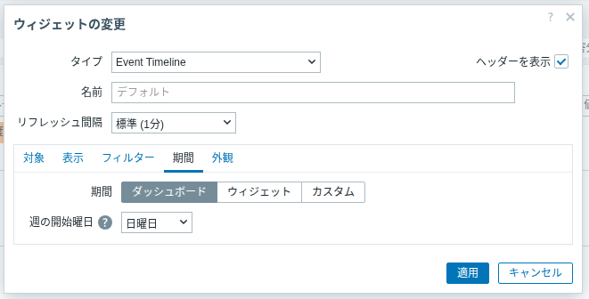</a>
    </td>
    <td align="center" valign="top" width="20%">
      <strong>外観</strong><br>
      <a href="docs/images/event-timeline-settings-appearance-ja.png">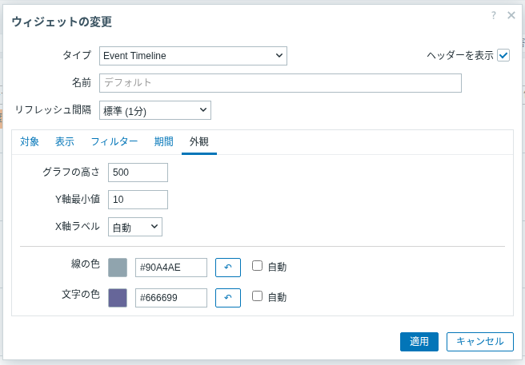</a>
    </td>
  </tr>
</table>

## 動作

### ナビゲータ連携

ナビゲータウィジェットのホスト・ホストグループ選択を表示対象に利用できます。

<a href="docs/images/event-timeline-navigator-integration.png">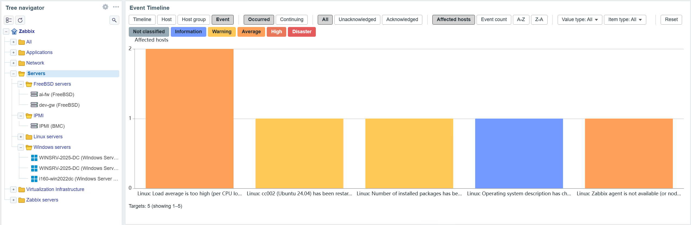</a>

### 分析対象の選択と絞り込み

監視対象とイベントは、それぞれ独立して Fixed または Widget を選択します。適用条件は、監視対象とイベント選択の両方を満たすことです。

対象とトリガーは固定指定のほか、連携可能なナビゲータウィジェットから受け取れます。テンプレート由来のトリガーを選択した場合は、継承元を基準に対象ホスト上の対応するトリガーを特定します。LLD 由来の場合も、生成元のトリガープロトタイプを基準に対応するトリガーを特定します。特定に必要なテンプレートを参照できない場合は、条件なしの全イベント表示へ切り替えず、警告を表示します。

#### ツールチップ

時間単位と深刻度に含まれるイベントをホスト単位または時系列で確認できます。

<a href="docs/images/event-timeline-tooltip.png">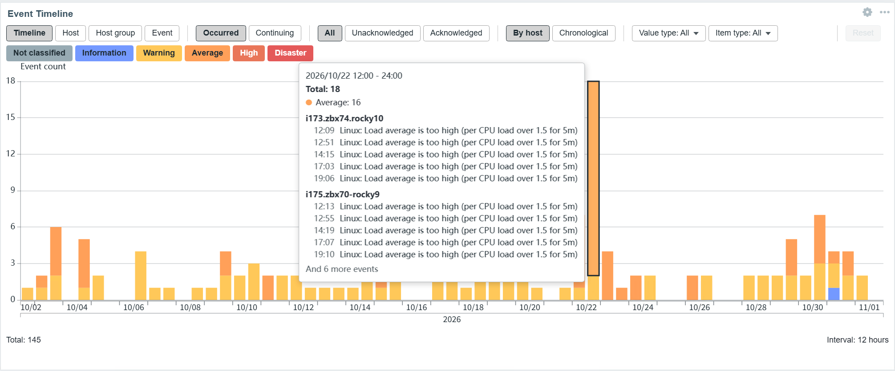</a>

- ナビゲータウィジェットからホストとホストグループを受け取れます。サブグループを含み、ホストは重複排除します。
- Triggers = Fixed は標準の選択 UI を使います。Triggers = Widget は連携元のナビゲータウィジェットからトリガー選択を受け取ります。
- トリガー未選択時は、対象ホストの期間内の全イベントを表示します。
- Widget から選択が届いていない場合は全ホスト・全イベントへ広げず、「対象が選択されていません」を表示します。
- 実行時の変更は保存設定を書き換えません。通常の更新では保持され、ダッシュボード再表示またはウィジェット再作成で設定値へ戻ります。

#### イベント数の数え方

- **発生イベント数**: イベントの開始時刻が属する時間単位に1回だけ加算します。境界は `start <= clock < end` です。
- **継続イベント加算**: `start < bucket_end AND end > bucket_start` を満たすすべての時間単位に加算します。未復旧イベントは現在時刻または期間終端までとし、未来の時間単位には加算しません。

時間軸は表示期間から100本以下になる最小の時間単位幅を自動選択します。X軸は最小時間単位を目盛りに表示し、日付と年を軸下の期間線で示します。

### トリガーの対象ホスト展開

トリガー選択とホスト選択を組み合わせると、選択したトリガーと同じテンプレートトリガーに由来する、対象ホスト上のトリガーのイベントを表示します。

#### ドリルダウン

棒グラフからイベント一覧を開き、状態、確認状況、復旧情報、一致したアイテムを確認できます。

<a href="docs/images/event-timeline-drilldown.png">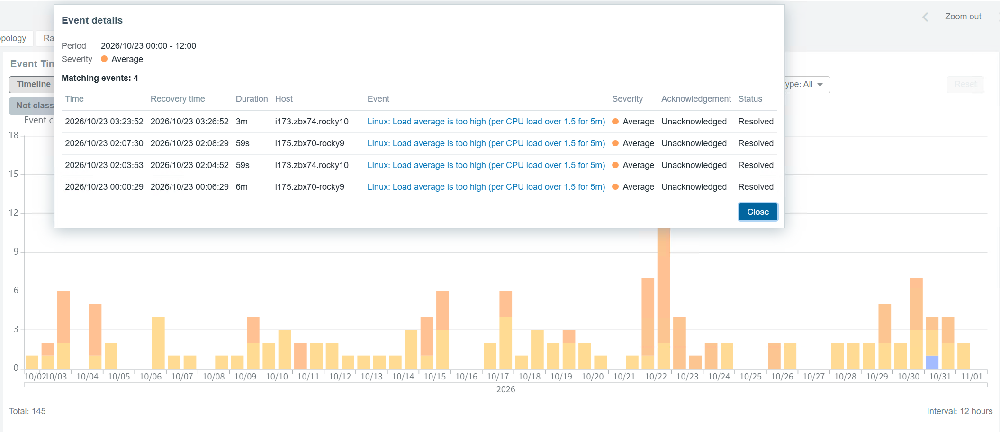</a>

- 一致判定にはトリガー ID と継承元（`templateid`）だけを使い、名前、条件式、深刻度は使いません。多段継承は最上位のテンプレートトリガーまで解決します。
- 複数選択は OR で結合し、重複を排除します。
- 対象ホストにテンプレートが適用されていない場合は一致なしとなるだけで、エラーにはしません。
- 展開結果が0件でも条件なしの全イベント表示には切り替えません。
- ホストへ直接作成したローカルトリガーは他ホストへ展開しません。自身のホストが対象の場合だけ使用します。
- 対象ホスト上のトリガーは一括取得し、ホスト数に応じて API 呼び出し回数が増える構造にはしていません。
- 選択したトリガー自体を解決できない場合は、選択全体を適用せず権限警告を表示します。
- 選択を解決できても対象ホスト上の一部の継承元を辿れない場合は、照合できた結果と部分結果の警告を表示します。

複数ホストのアイテムを参照するトリガーは正式対応外です。1つのトリガーとして扱い、参照先ホストのいずれかが対象に含まれると一致します。

### LLD トリガーの対象ホスト展開

自動生成されたトリガーを選択すると、生成元トリガープロトタイプからテンプレート継承をたどり、継承元を持たない最上位のトリガープロトタイプ（以下「最上位プロトタイプ」）を特定します。対象ホスト上で同じ最上位プロトタイプに由来する自動生成されたトリガーのイベントを表示します。

<a href="docs/images/event-timeline-lld-expansion.png">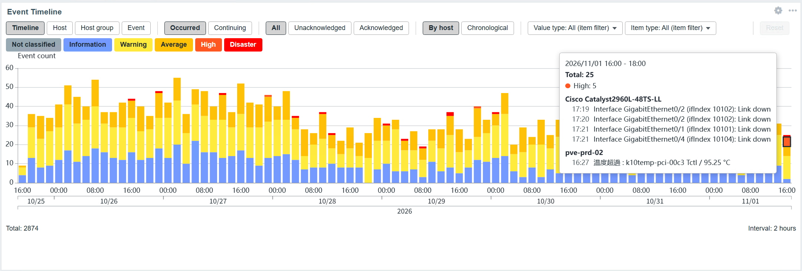</a>

- `{#IFNAME}` などの LLD マクロ値では絞り込みません。同じプロトタイプから生成されたすべてのトリガーが対象です。
- 判定にはプロトタイプ ID、継承関係、生成元の関係だけを使い、名前、条件式、深刻度、マクロ値から推測しません。
- ホストローカルのプロトタイプは、同じホスト上の自身から生成されたトリガーだけに一致します。
- 通常トリガーと LLD トリガーは同時に選択でき、結果を OR で結合して重複排除します。
- Lost のトリガーは Zabbix に存在する間は対象です。削除済みトリガーとその過去イベントは取得できず、名前から推測しません。
- 生成元プロトタイプと継承元プロトタイプの参照権限が必要です。安全に解決できない場合は、条件なしの表示へ切り替えません。
- イベント表示では最上位プロトタイプ単位で集計します。継承元を解決できない場合はホスト単位に分割される可能性があり、警告を表示します。

ネストした LLD では、外側の LLD がホスト・検出行ごとに生成したプロトタイプを最上位プロトタイプとして扱うため、展開と集計は同じホスト・外側の検出行に限定されます。

### アイテム条件による絞り込み

トリガーが直接参照するアイテムの「値の型」と「アイテムタイプ」でイベントを絞り込めます。

#### 実行時フィルター

深刻度、確認状態、値の型、アイテムタイプ、イベント数の数え方を一時的に変更できます。

<a href="docs/images/event-timeline-runtime-filters.png"></a>

- 同じ軸の複数選択は OR、値の型とアイテムタイプは AND です。両方を指定した場合は同じアイテムが両条件を満たす必要があります。
- 参照アイテムの1件以上が一致すればトリガーが一致します。複数アイテムが一致してもイベントは重複しません。
- 関係の判定には Zabbix の構造情報（`trigger.get` の functions）だけを使い、条件式、名前、アイテムキーを解析しません。
- 通常トリガーと LLD トリガーに対応し、LLD は実際に生成されたアイテムの型で判定します。
- 依存アイテムは「依存アイテム」として扱い、マスターアイテムのタイプへ遡りません。
- 対象ホスト外のアイテムを含む全参照アイテムを判定します。無効アイテムも過去イベントの判定対象です。
- 条件適用中のドリルダウンでは、一致したアイテムのホスト、名前、キー、値の型、アイテムタイプを表示します。
- 判定には表示時点の Zabbix 構成を使い、イベント発生時点の構成は再現しません。
- アイテム情報を安全に取得できない場合は、確認できた一致だけを表示して部分結果の警告を出します。正常な0件では警告しません。

### 表示とツールチップ

- **タイムライン**: Y軸は現在の実行時フィルター下のイベント件数です。
- **ホスト / ホストグループ**: 1本の棒が1ホストまたは1グループで、深刻度を積み上げます。件数順、A–Z、Z–A で並べ替えられます。
- **イベント**: 1本の棒が1トリガーまたはプロトタイプグループで、高さは影響ホスト数です。影響ホスト数順、イベント発生数順、A–Z、Z–A を選べます。
- **ツールチップ**: 時間単位の範囲、合計、マウスポインターを重ねた深刻度、時間単位 × 深刻度あたり最大10件の詳細を表示し、残りを「ほか N イベント」とまとめます。
- **詳細**: 棒をクリックするとページング付きのイベント一覧を開きます。イベント名から利用可能な Zabbix 標準イベントメニューを開けます。

### トリガー連携に必要な権限

テンプレート由来のトリガーを利用するユーザーには、継承チェーン上のすべてのテンプレートに対する読み取り権限が必要です。Event Timeline は Zabbix の権限を迂回しません。

- 選択したトリガーを1件でも解決できない場合は、選択全体を利用不可とし、解決できた一部だけでは絞り込みません。
- 権限警告は、正常なイベント0件の表示とは区別されます。
- LLD トリガーでは生成元トリガープロトタイプと継承元プロトタイプへの参照権限も必要です。
- ホストローカルのトリガーでは、この解決処理のためのテンプレート参照権限は不要です。
- 選択を解除するか解決可能なトリガーへ変更すると、ページ再読み込みなしで通常表示へ戻ります。

### 自動ページ切替

ホスト、ホストグループ、イベント表示をページ分割し、設定した間隔で自動切替できます。マウスポインターを重ねている間やページ非表示時は停止し、操作後は次の間隔から再開します。

<a href="docs/images/event-timeline-auto-paging.png">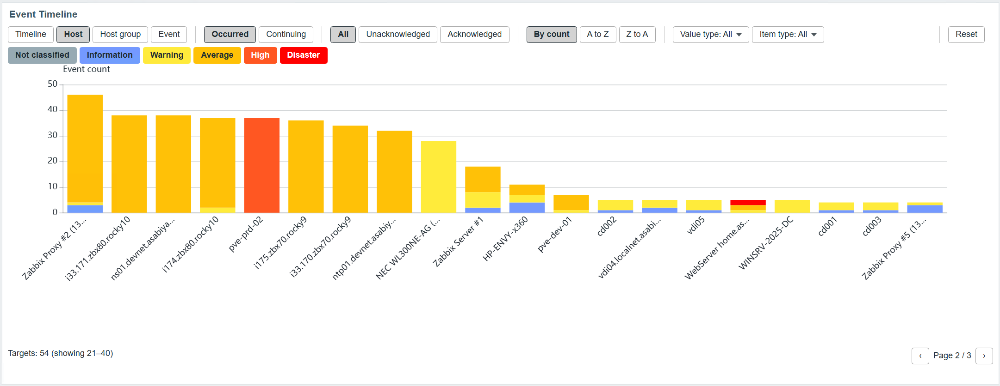</a>

### 状態表示

#### イベントなし

現在の条件に一致する障害イベントがない場合も、軸、グリッド、集計情報を残して状態を明示します。

<a href="docs/images/event-timeline-empty-state.png">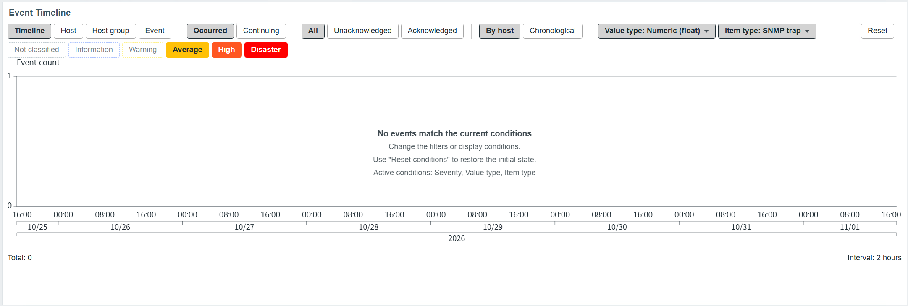</a>

#### 取得上限の警告

イベント取得上限に達した場合は、結果が一部であることと集計対象外の期間を警告します。

<a href="docs/images/event-timeline-event-limit-warning.png">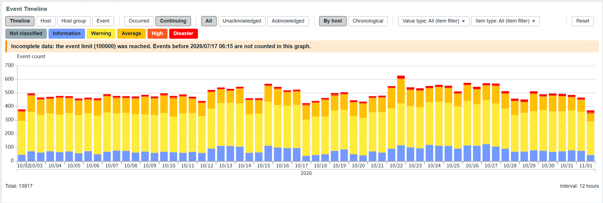</a>

### テーマ

#### ダークテーマ

Zabbix のダークテーマに合わせて線と文字の色を調整し、グラフの視認性を維持します。

<a href="docs/images/event-timeline-dark-theme.png">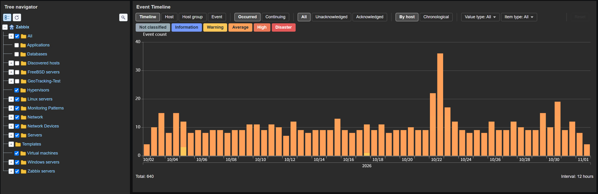</a>

## 制約事項

- イベントは5,000件単位で取得します。取得上限に達すると古いイベントから対象外になります。継続モードでは表示期間より前に始まったイベントも上限に含みます。
- 約8年を超える期間では1か月の時間単位でも100本を超える場合があります。通常、Zabbix の表示期間上限は730日です。
- 監視の有効 / 無効を区別しません。
- 削除済みのトリガーとアイテムは取得できず、過去イベントも表示しません。
- アイテムタイプの判定で、依存アイテムのマスターへは遡りません。
- 複数ホストのアイテムを参照するトリガーとトリガープロトタイプは正式対応外です。
- Zabbix 8.0 のネストした LLD は、前述のとおり同一ホスト・外側の検出行に限定されます。
- テンプレート選択と無関係でも、継承元を解決できない対象ホスト上のトリガーを安全側で PARTIAL と数える場合があります。条件なしの全イベント表示へ切り替えないための挙動です。
- PARTIAL 警告は本体に表示しますが、ドリルダウンダイアログでは再表示しません。
- 実用上の最小幅は約216pxです。約400px未満ではツールバーが折り返し、グラフをウィジェット内で縦スクロールします。
- 解決結果などのデバッグ情報は Zabbix デバッグモードのユーザーだけに返し、`console.debug` へ出力します。画面には表示しません。
- Zabbix 8.0 以降は `trigger.get` の `selectDiscoveryData`、7.0 は `selectTriggerDiscovery` を使用します。

## 動作要件

| 項目 | 要件 / 確認実績 |
| --- | --- |
| Zabbix | 7.0.x（7.0.31 で動作確認）、8.0.0 で動作確認 |
| PHP | 8.1 以上（8.3 / 8.4 で動作確認） |
| パッケージ対象 OS | RHEL 互換 9 / 10（RPM）、Ubuntu 22.04 / 24.04（DEB） |
| 権限 | 対象ホストの読み取り権限。テンプレート由来のトリガーでは、継承チェーン上のすべてのテンプレートに対する読み取り権限も必要です。 |

## インストール

RPM / DEB パッケージ、または GitHub Release に添付したソース ZIP からインストールします。正式なソースアーカイブは `zabbix-widget-event-timeline-v1.0.1.zip` です。自動生成される「Source code」アーカイブとは展開後のディレクトリ名が異なります。

### RPM パッケージ

```bash
rpm -Uvh zabbix-widget-event-timeline-1.0.1.noarch.rpm
```

### DEB パッケージ

```bash
dpkg -i zabbix-widget-event-timeline_1.0.1_all.deb
```

パッケージは `/usr/share/zabbix-widget-event-timeline/` にファイルを置き、`/usr/share/zabbix/ui/modules` があれば `event-timeline` をその下へ、なければ `/usr/share/zabbix/modules` へコピーします。両方がない場合は警告し、モジュールをコピーしません。パッケージに `tests/` は含みません。

### 手動インストール

```bash
unzip zabbix-widget-event-timeline-v1.0.1.zip
# このディレクトリが存在する場合はこちらを優先
cp -r zabbix-widget-event-timeline-v1.0.1 /usr/share/zabbix/ui/modules/event-timeline
# 上記が存在しない場合
cp -r zabbix-widget-event-timeline-v1.0.1 /usr/share/zabbix/modules/event-timeline
```

`tests/` は実行時には不要です。

### インストール後の操作

1. PHP の実行環境を再読み込みします。例: RHEL 互換の PHP-FPM 構成では `systemctl reload php-fpm`、Ubuntu の Apache 構成では `systemctl reload apache2`。
2. Zabbix の「管理 → 一般設定 → モジュール」で「ディレクトリスキャン」を実行し、初回のみ Event Timeline を有効にします。
3. ダッシュボードへ Event Timeline ウィジェットを追加します。

## アップデート

```bash
# RPM
rpm -Uvh zabbix-widget-event-timeline-<version>.noarch.rpm
# DEB
dpkg -i zabbix-widget-event-timeline_<version>_all.deb
```

パッケージ更新ではモジュールディレクトリを新しい版に置き換えます。手動更新では削除済みファイルが残らないよう、既存の `event-timeline` を削除してから新しい版をコピーしてください。更新後は PHP を再読み込みします。モジュールの再スキャン・再有効化は不要です。モジュール ID と設定保存形式は変わらないため、既存設定の移行作業も不要です。

## アンインストール

```bash
# RPM
rpm -e zabbix-widget-event-timeline
# DEB
dpkg -r zabbix-widget-event-timeline
```

事前にダッシュボードからウィジェットを削除するか、モジュールを無効にしてください。パッケージ削除ではモジュールディレクトリも削除します。手動インストールではモジュールを無効にして `event-timeline` を削除します。その後 PHP を再読み込みし、「ディレクトリスキャン」でモジュール登録を削除します。

## テスト

```bash
php tests/run_tests.php
php tests/run_final_tests.php
```

時間単位の選択と境界、DST、全7曜日の週開始設定、深刻度集計などの純粋ロジックを検証します。`tests/` はソース ZIP にだけ含まれます。

## 今後の改善候補

- ネストした LLD トリガーを、テンプレート上のトリガープロトタイプ単位で照合・集計すること。
- ドリルダウンダイアログで PARTIAL 警告を再表示すること。

## ライセンス

MIT License。`LICENSE` を参照してください。

Copyright (c) 2026 ttake-55<br>
HOLOZTEK by ttake-55

同梱の Apache ECharts（`assets/js/echarts.min.js`、ZRender を含む）は Apache License 2.0 です。`NOTICE` と `THIRD_PARTY_NOTICES.md` を参照してください。
