# zabbix-widget-event-timeline

[English](README.md) | [日本語](README.ja.md)

## Overview

Event Timeline visualizes Zabbix events by time, host, host group, and event, allowing operators to switch the analysis scope directly on a dashboard.

[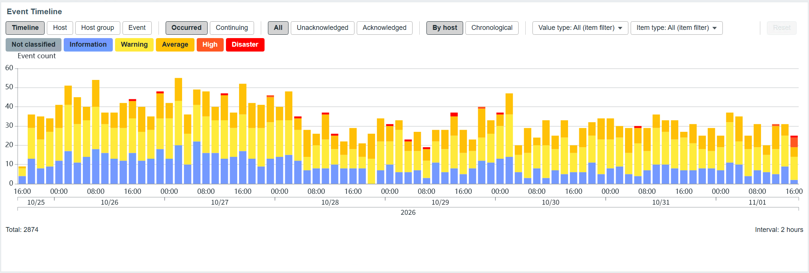](docs/images/event-timeline-dashboard-overview.png)

## Why Event Timeline?

In environments where large numbers of problem events are recorded every day, table-based problem views alone make it difficult to recognize trends and changes in event occurrence.

Event Timeline Widget displays problem-event counts per time bucket as a bar chart. In addition to showing volume and trends over time, it can switch among host, host-group, and event-type perspectives to visualize where problems occur and which types of problems are concentrated.

## Features

- **Four display modes**: switch between timeline, host, host group, and event views, with tooltips and drilldown for details.
- **In-view filters**: narrow results temporarily by severity, acknowledgement, value type, and item type, then reset to the configured initial state.
- **Widget integration**: receive hosts, host groups, and triggers from compatible navigator widgets.
- **Template inheritance and LLD**: trace trigger inheritance and trigger prototypes by IDs and structural data to show the corresponding events on target hosts.
- **Aggregation and paging**: choose occurred or continuing event counts, sort results, page manually, or rotate pages automatically.
- **Time axis**: select bucket size automatically for the displayed period and honor the user's time zone, local calendar, first day of week, and DST.
- **Display and locales**: use standard Zabbix severity colors with light/dark themes and Japanese/English locales.

### Display modes

| Timeline | Host |
| --- | --- |
| Splits the displayed period into automatically selected time buckets and shows problem-event counts as severity-stacked bars. | Compares problem-event counts by host and supports sorting and paging. |
| [](docs/images/event-timeline-timeline-view.png) | [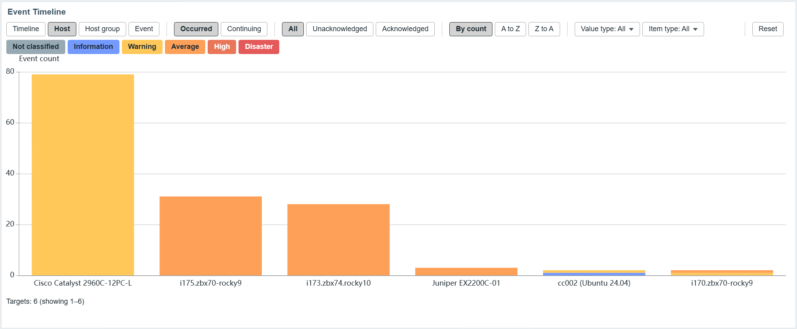](docs/images/event-timeline-by-host.png) |
| **Host group** | **Event** |
| Compares problem-event counts by host group to identify where the impact is concentrated. | Compares affected-host and event counts by trigger or top-level inherited prototype. |
| [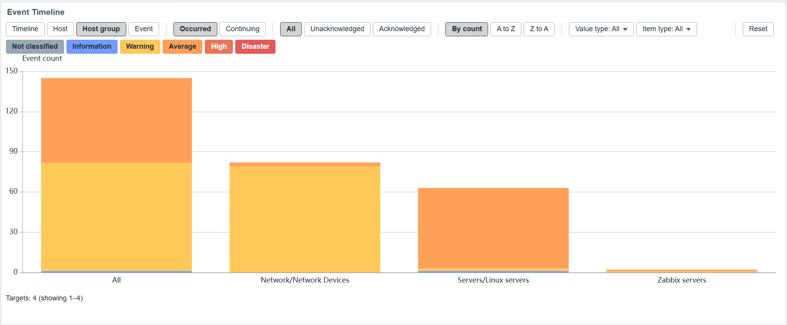](docs/images/event-timeline-by-host-group.png) | [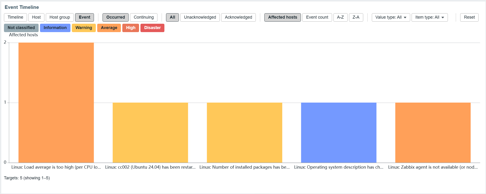](docs/images/event-timeline-by-event.png) |

## Configuration

The form has five tabs. Type, Name, Refresh interval, and Show header remain outside the tabs as in standard Zabbix widgets.

| Tab | Fields |
| --- | --- |
| Targets | Hosts, Host groups, Triggers, Event retrieval limit |
| Display | Display mode, Event grouping, Sort order, Aggregation method, Chart items per page, Auto paging, Detail items per page |
| Filters | Severity, Acknowledgement, Value type, Item type |
| Time period | Time period, First day of week |
| Appearance | Graph height, Y-axis minimum, X-axis labels, Line color, Text color |

The form opens on Targets and preserves unsaved values while switching tabs. Validation marks every tab containing an error, opens the first invalid tab, and focuses the field. At least one severity and acknowledgement status are required. Value type and Item type use an exclusive "All" option to represent no restriction.

Select any image to inspect the settings at full size.

<table>
  <tr>
    <td align="center" valign="top" width="20%">
      <strong>Targets</strong><br>
      <a href="docs/images/event-timeline-settings-targets.png">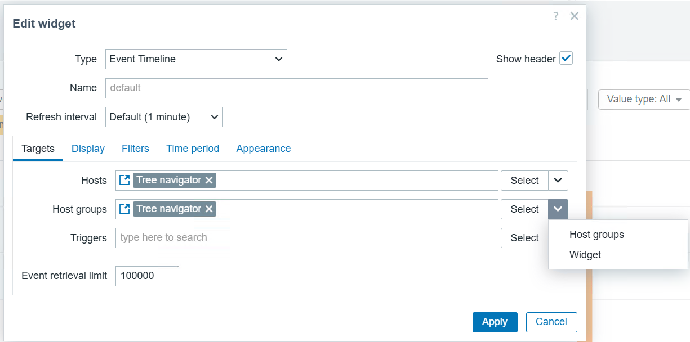</a>
    </td>
    <td align="center" valign="top" width="20%">
      <strong>Display</strong><br>
      <a href="docs/images/event-timeline-settings-display.png">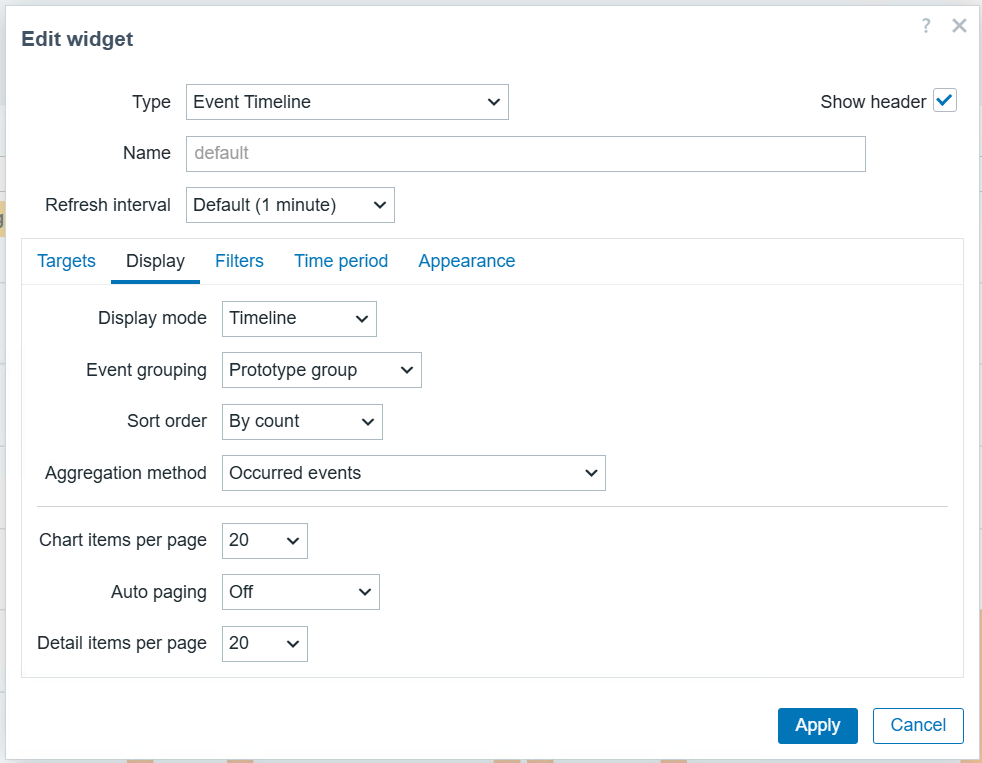</a>
    </td>
    <td align="center" valign="top" width="20%">
      <strong>Filters</strong><br>
      <a href="docs/images/event-timeline-settings-filters.png">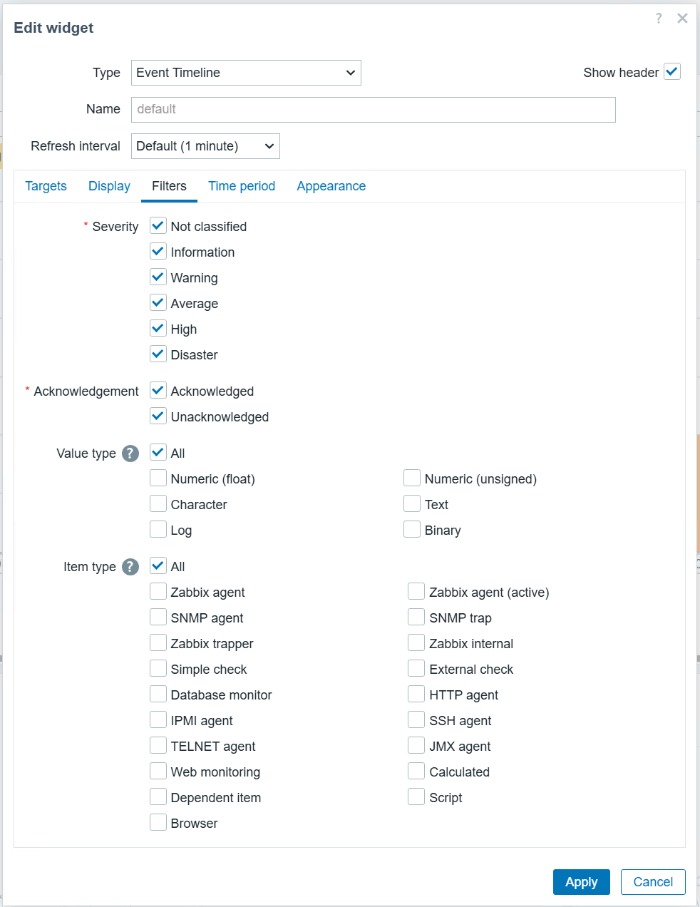</a>
    </td>
    <td align="center" valign="top" width="20%">
      <strong>Time period</strong><br>
      <a href="docs/images/event-timeline-settings-time-period.png">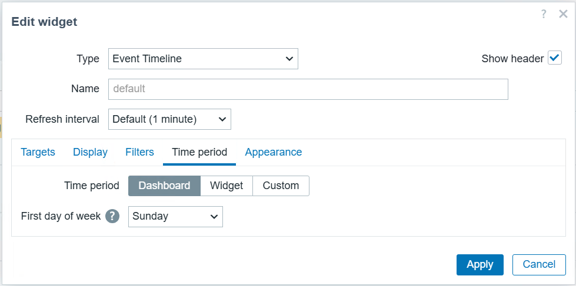</a>
    </td>
    <td align="center" valign="top" width="20%">
      <strong>Appearance</strong><br>
      <a href="docs/images/event-timeline-settings-appearance.png">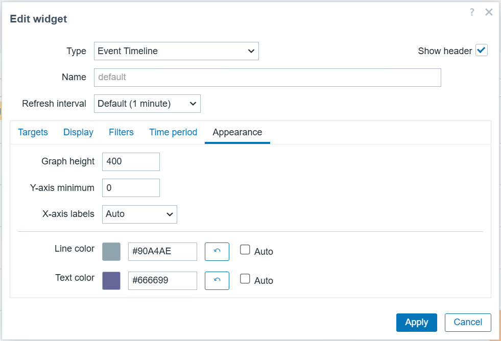</a>
    </td>
  </tr>
</table>

## Behavior

### Navigator integration

Host and host-group selections from a navigator widget can drive the displayed targets.

<a href="docs/images/event-timeline-navigator-integration.png">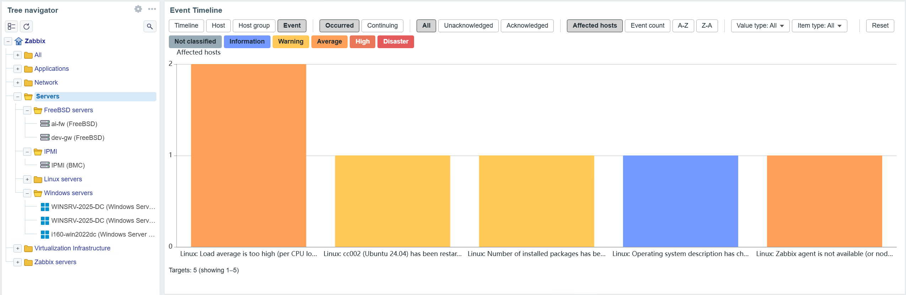</a>

### Selecting and narrowing the analysis scope

Monitoring target and Event are configured independently as Fixed or Widget. The resulting condition is `Monitoring target AND Event selection`.

Targets and triggers can be fixed or received from compatible navigator widgets. For a template-derived trigger, the widget uses its inherited source to identify the corresponding triggers on the target hosts. For an LLD-derived trigger, it uses the parent trigger prototype in the same way. If a required template cannot be accessed, the widget shows a warning instead of falling back to unfiltered events.

#### Tooltip

Events in a bucket and severity can be inspected by host or chronologically.

<a href="docs/images/event-timeline-tooltip.png">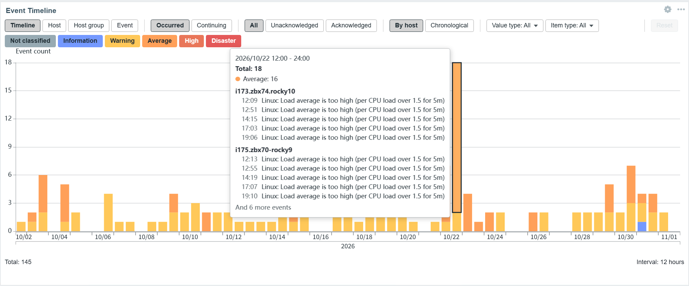</a>

- A navigator widget can provide hosts and host groups; subgroups are included and hosts are deduplicated.
- Fixed triggers use the standard selector. Widget triggers are received from a compatible navigator widget.
- Without a trigger selection, all events for the target hosts in the period are included.
- If a widget source has not sent a selection, the widget shows "No target selected" rather than widening the scope to all hosts or events.
- Runtime changes do not modify the saved configuration. They survive normal refreshes and reset when the dashboard is reloaded or the widget is recreated.

#### Event count modes

- **Occurred**: counts an event once in the bucket containing its start time. Bucket membership uses `start <= clock < end`.
- **Continuing**: counts an event in every bucket satisfying `start < bucket_end AND end > bucket_start`. Unresolved events continue only through the current time or period end and are never added to future buckets.

The time axis automatically selects the smallest bucket size that keeps the displayed period at or below 100 buckets. It shows the smallest time unit as ticks and dates and years as period lines below the axis.

### Expanding triggers to target hosts

When a trigger selection is combined with a host selection, Event Timeline shows events from triggers on the target hosts that derive from the same template trigger as the selected trigger.

#### Drilldown

Open the event list from a bar to inspect status, acknowledgement, recovery, and matching items.

<a href="docs/images/event-timeline-drilldown.png">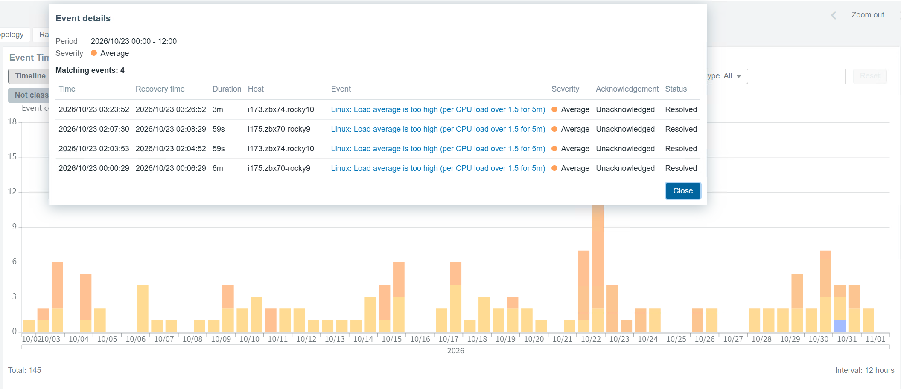</a>

- Matching uses trigger IDs and inheritance (`templateid`), never names, expressions, or severity. Multi-level inheritance resolves to the top-level template trigger.
- Multiple selected triggers are combined with OR and deduplicated.
- A target host without the template simply has no matching trigger; this is not an error.
- If expansion finds no match, the result is "No events" and never falls back to unfiltered events.
- Host-local triggers are not expanded to other hosts. They are used only when their own host is a target.
- Triggers on the target hosts are fetched in bulk; the API-call count does not grow with the host count.
- If a selected trigger itself cannot be resolved, the whole selection is rejected with a permission warning.
- If the selection is resolved but inheritance for some target-host triggers cannot be traced, matched results are shown with a partial-result warning.

Triggers that reference items on multiple hosts are not officially supported. Such a trigger is treated as one trigger and matches when any referenced host is a target.

### Expanding LLD triggers

When a discovered trigger is selected, Event Timeline resolves its parent trigger prototype and template inheritance to a canonical trigger prototype, then includes discovered triggers on the target hosts derived from the same canonical prototype.

<a href="docs/images/event-timeline-lld-expansion.png">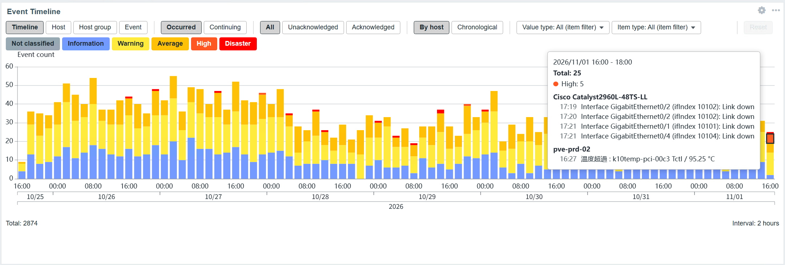</a>

- LLD macro values such as `{#IFNAME}` are not used for matching; all triggers from the same prototype are included.
- Matching uses prototype IDs, inheritance, and the discovery relationship. Names, expressions, severities, and macro values are never guessed.
- Host-local prototypes match only discovered triggers from that prototype on the same host.
- Normal and LLD trigger selections can be combined; their results are unioned and deduplicated.
- Lost triggers pending deletion are included while they exist in Zabbix. Deleted triggers and their past events cannot be retrieved and are not inferred from names.
- Access to the parent and inherited prototypes is required. Resolution is fail-closed.
- Event mode groups prototypes by canonical trigger prototype. Unresolvable inheritance may split groups per host and produces a warning.

Nested LLD has been tested with Zabbix 8.0.0rc3. Its canonical prototype is the prototype generated by the outer LLD per host and outer discovery row, so expansion and grouping remain limited to that host and outer row.

### Filtering events by item characteristics

Events can be filtered by the value type and item type of items directly referenced by each trigger.

#### Runtime filters

Temporarily change severity, acknowledgement, value type, item type, and event-count mode.

<a href="docs/images/event-timeline-runtime-filters.png">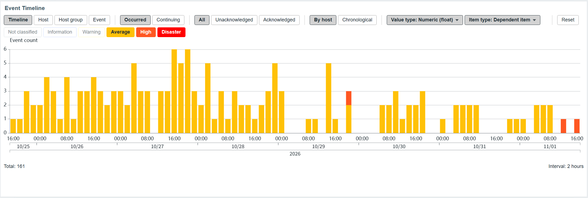</a>

- Multiple values on the same axis use OR. Value type and item type use AND, and the same item must satisfy both.
- A trigger matches when at least one referenced item matches. Events are never duplicated when several items match.
- Relationships come only from Zabbix structural data (`trigger.get` functions); expressions, names, and item keys are not parsed.
- Both normal and LLD triggers are supported. LLD triggers are evaluated using their discovered items.
- Dependent items are classified as Dependent item; the master item's type is not followed.
- All referenced items are evaluated, including items on hosts outside the target hosts. Disabled items remain eligible for past events.
- When filters are active, drilldown shows the matching items with host, name, key, value type, and item type.
- Classification uses the current Zabbix configuration, not the configuration at the event time.
- If item information cannot be retrieved safely, only confirmed matches are shown with a partial-result warning. A normal zero-match result has no warning.

### Display and tooltips

- **Timeline**: the Y axis is the number of events under the active runtime filters.
- **Host / Host group**: each bar represents a host or group and is stacked by severity. Sorting supports count, A–Z, and Z–A.
- **Event**: each bar represents a trigger or prototype group and its height is the number of affected hosts. Sorting supports affected-host count, event count, A–Z, and Z–A.
- **Tooltip**: shows the bucket range, total, hovered severity, and up to 10 event details per bucket and severity; remaining entries are summarized as "N more events".
- **Details**: clicking a bar opens paged event details. Clicking an event name opens the standard Zabbix event menu when available.

### Permissions required for trigger integration

The logged-in user must be able to access every template in the inheritance chain of a template-derived trigger. Event Timeline never bypasses Zabbix permissions.

- If any selected trigger cannot be resolved, the whole selection is unusable; results are not filtered by only the resolvable subset.
- The widget shows a permission warning distinct from a normal zero-event result.
- LLD triggers also require access to the parent trigger prototype and inherited prototypes.
- Host-local triggers do not require template access for this resolution step.
- Clearing or replacing the trigger selection restores normal display without reloading the page.

### Automatic paging

Host, host-group, and event views can be split into pages and rotated automatically at the configured interval. Rotation pauses while hovered or while the page is hidden and resumes after interaction.

<a href="docs/images/event-timeline-auto-paging.png">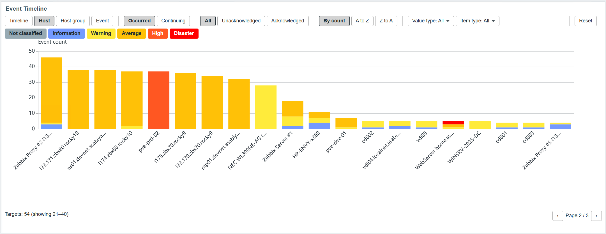</a>

### States

| No events | Retrieval-limit warning |
| --- | --- |
| Keeps the axes, grid, and summary visible and clearly states when no problem events match the current conditions. | Warns that results are partial and identifies the excluded period when the event retrieval limit is reached. |
| [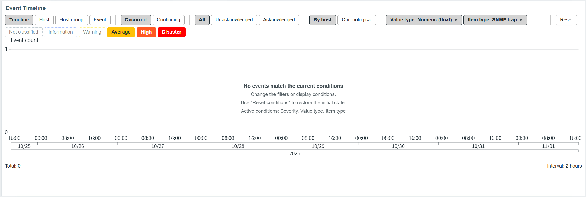](docs/images/event-timeline-empty-state.png) | [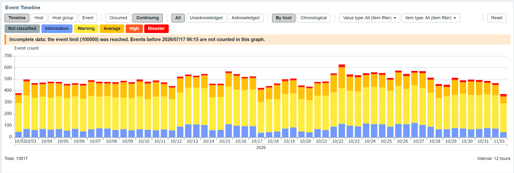](docs/images/event-timeline-event-limit-warning.png) |

### Theme

#### Dark theme

Adjusts line and text colors for the Zabbix dark theme to keep the chart readable.

<a href="docs/images/event-timeline-dark-theme.png">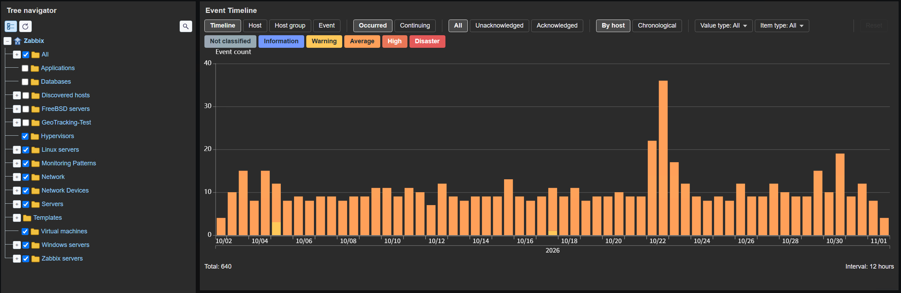</a>

## Known limitations

- Events are fetched in pages of 5,000. At the retrieval limit, the oldest events are excluded. Continuing mode also counts events that began before the displayed period toward this limit.
- Periods longer than about eight years can exceed 100 buckets even with one-month buckets; Zabbix normally limits dashboard periods to 730 days.
- Monitored and unmonitored hosts are not distinguished.
- Deleted triggers and items cannot be retrieved, so their past events are not shown.
- Item-type filtering does not follow a dependent item's master.
- Triggers and prototypes referencing items on multiple hosts are not officially supported.
- Nested LLD on Zabbix 8.0 is limited to the same host and outer discovery row as described above.
- An unresolvable target-host trigger may be conservatively counted as PARTIAL even when unrelated to a template selection. This avoids fail-open behavior.
- The PARTIAL warning is shown in the main view but is not repeated in the drilldown dialog.
- The practical minimum width is about 216 px. Below about 400 px, toolbar buttons wrap and the chart scrolls vertically inside the widget.
- Zabbix 8.0 final has not been tested; testing currently covers 8.0.0rc3.
- Debug resolution data is returned only for users with Zabbix debug mode and is written to `console.debug`, never to the visible UI.
- Zabbix 8.0 and later use `trigger.get` with `selectDiscoveryData`; Zabbix 7.0 uses `selectTriggerDiscovery`.

## Requirements

| Item | Requirement / verification |
| --- | --- |
| Zabbix | 7.0.x (tested with 7.0.31); tested with 8.0.0rc3. The Zabbix 8.0 final release has not been tested. |
| PHP | 8.1 or later (tested with 8.3 / 8.4) |
| Package OS | RHEL-compatible 9 / 10 (RPM), Ubuntu 22.04 / 24.04 (DEB) |
| Permissions | Read access to the target hosts; for template-inherited triggers, also access to every template in the inheritance chain. |

## Installation

Install the RPM / DEB package or use the source ZIP attached to the GitHub release. The official source archive is `zabbix-widget-event-timeline-v1.0.0.zip`; the automatically generated "Source code" archives use a different extracted-directory name.

### RPM package

```bash
rpm -Uvh zabbix-widget-event-timeline-1.0.0.noarch.rpm
```

### DEB package

```bash
dpkg -i zabbix-widget-event-timeline_1.0.0_all.deb
```

Packages install files under `/usr/share/zabbix-widget-event-timeline/` and copy the module to `event-timeline` under `/usr/share/zabbix/ui/modules` when present, otherwise `/usr/share/zabbix/modules`. If neither exists, the installer warns and does not copy the module. Packages do not include `tests/`.

### Manual installation

```bash
unzip zabbix-widget-event-timeline-v1.0.0.zip
# Preferred when this directory exists
cp -r zabbix-widget-event-timeline-v1.0.0 /usr/share/zabbix/ui/modules/event-timeline
# Otherwise
cp -r zabbix-widget-event-timeline-v1.0.0 /usr/share/zabbix/modules/event-timeline
```

`tests/` is not required at runtime.

### After installation

1. Reload PHP, for example `systemctl reload php-fpm` on RHEL-compatible PHP-FPM systems or `systemctl reload apache2` on Ubuntu with Apache.
2. Open Administration → General → Modules, click "Scan directory", and enable Event Timeline the first time.
3. Add the Event Timeline widget to a dashboard.

## Update

```bash
# RPM
rpm -Uvh zabbix-widget-event-timeline-<version>.noarch.rpm
# DEB
dpkg -i zabbix-widget-event-timeline_<version>_all.deb
```

Package updates replace the module directory. For a manual update, delete the old `event-timeline` directory before copying the newly extracted version so removed files do not remain. Reload PHP afterward; rescanning and re-enabling are unnecessary. The module ID and saved configuration format are unchanged, so existing widget configurations require no migration.

## Uninstall

```bash
# RPM
rpm -e zabbix-widget-event-timeline
# DEB
dpkg -r zabbix-widget-event-timeline
```

Remove the widgets from dashboards or disable the module first. Package removal also removes the module directory. For a manual installation, disable the module and delete `event-timeline`. Reload PHP and run "Scan directory" again to remove the module registration.

## Tests

```bash
php tests/run_tests.php
php tests/run_final_tests.php
```

These scripts test pure logic including bucket selection and boundaries, DST, every first-day-of-week setting, and severity aggregation. `tests/` is included only in the source ZIP.

## Potential future improvements

- Test with the Zabbix 8.0 final release.
- Match and group nested LLD triggers by the trigger prototype on the template.
- Repeat the PARTIAL warning in the drilldown dialog.

## License

MIT License; see `LICENSE`.

Copyright (c) 2026 ttake-55<br>
HOLOZTEK by ttake-55

The bundled Apache ECharts (`assets/js/echarts.min.js`, including ZRender) is licensed under the Apache License 2.0; see `NOTICE` and `THIRD_PARTY_NOTICES.md`.
